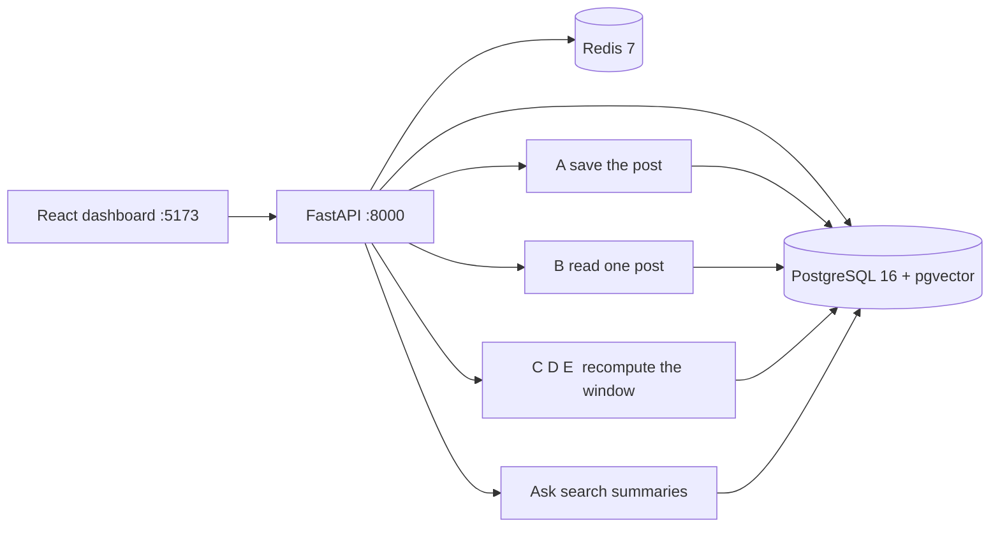

# AI-Driven Social Media Audience Intelligence Framework

Academic proof of concept for a 7th-semester CSE minor project. Team of 4. September–December 2026.

The prototype collects public Telegram posts and presents them through seven dashboard pages. Each post can be read for wording, emotion, and stance. A time window can then be summarised as an audience sketch, a set of themes, and an interaction graph. A question on the Ask page is answered from those summaries, and only when a retrieved summary is close enough to cite.

The National Technical Research Organisation published the problem statement that motivated the work. This repository is the student testbed built for the viva. It is a research prototype on public posts. Accuracy percentages are omitted because the labelled comparison in Phase 5 has not been run.

The demonstration that must work in the exam room is the offline seed and the local dashboard. Live Telegram and an online language model are optional depth. A dropped campus network, a Telegram wait, or a missing API key leaves the seed path intact.

| | |
| --- | --- |
| Course | COM-711, 7th-semester CSE minor project |
| Reference machine | NVIDIA GeForce GTX 1650 Ti, 4 GB VRAM, 16 GB RAM, Windows 11 |
| CPU fallback | Same code and the same labels. The run takes longer. |
| Language and services | Python 3.11, FastAPI, PostgreSQL 16 + pgvector, Redis 7, React 18, Vite 6 |
| Operating scale | About 30 public channels, hundreds to a few thousand posts |
| Review batch | At most 50 posts with text |

## Contents

1. [Purpose](#1-purpose)
2. [Scope](#2-scope)
3. [Architecture](#3-architecture)
4. [Component A — collection](#4-component-a--collection)
5. [Component B — one post](#5-component-b--one-post)
6. [Component C — audience](#6-component-c--audience)
7. [Component D — themes](#7-component-d--themes)
8. [Component E — network](#8-component-e--network)
9. [Ask](#9-ask)
10. [Stored data](#10-stored-data)
11. [Dashboard and API](#11-dashboard-and-api)
12. [Models and the 4 GB limit](#12-models-and-the-4-gb-limit)
13. [Configuration](#13-configuration)
14. [How to run it](#14-how-to-run-it)
15. [Demonstration](#15-demonstration)
16. [Implementation status](#16-implementation-status)
17. [Engineering record](#17-engineering-record)
18. [Documents](#18-documents)
19. [Repository map](#19-repository-map)

## 1. Purpose

The dashboard answers five questions about a recent window of public posts.

| Question | Where it is answered |
| --- | --- |
| How does the wording lean, and how do the emoji reactions differ from that reading? | Sentiment |
| Which clusters of similar posts arrive faster in the second half of the window? | Trends |
| What can be said about the group that spoke, without assigning an age or a place to one named person? | Audience |
| Which accounts sit on the paths between others, and which behaviour scores are high enough to inspect? | Network |
| What do the system's own summaries say, and when is a question left unanswered? | Ask |

Overview shows the saved posts themselves: the photograph, the full caption, the reaction counts, and the comments. Sources shows where those rows came from. Ask searches stored summaries. It receives the passages that cleared the distance cutoff, and it records every question.

## 2. Scope

| Inside this prototype | Outside this prototype |
| --- | --- |
| Public Telegram channels and groups | Private one-to-one chats as a collection design |
| Offline seed, desktop export, and an optional live reader | A requirement that the exam use the live account |
| Five analysis components and one coordinator | LangGraph, CrewAI, or another agent framework |
| Seven dashboard pages over HTTP | A PDF button in the dashboard, or a live socket |
| Aggregate audience sketches, with a floor of 50 accounts | A dossier on one person |
| An advisory behaviour score from 0.0 to 1.0 | A verdict that an account is a bot or that a campaign is real |
| Published models, used as released | A model trained by the team, or a quoted accuracy |

X/Twitter, Reddit, YouTube, Instagram, and Facebook are absent from the collector. A later report may discuss an offline coordination file for two of the three network signals. That file has not been scored, so this document quotes neither precision nor recall.

The review button is specified for a batch of at most 50 posts. It is specified for the reference GPU. A CPU laptop, and any run over the whole archive, sit outside that timing.

## 3. Architecture

The browser calls FastAPI. FastAPI reads and writes PostgreSQL. Redis is the broker for the optional Celery cycle. Docker runs PostgreSQL 16 with pgvector, and Redis 7. The API, the models, and the website run on the host.



The letter on each component is stable. The same letter appears on the package, the tables, and the review brief.

| Letter | Package | Work | Tables |
| --- | --- | --- | --- |
| A | `ingestion_a/` | Save public posts | `monitored_channels`, `raw_posts`, `raw_authors`, `ingestion_runs` |
| B | `sentiment_b/` | Read one post | `sentiment_results_b` |
| C | `demographic_c/` | Sketch a group | `demographic_aggregates_c` |
| D | `trend_d/` | Themes and their speed | `trend_topics_d` |
| E | `network_e/` | Graph and behaviour screen | `network_nodes_e`, `network_edges_e` |
| — | `orchestrator/` | Run B, then refresh C, D, and E | — |
| — | `rag/` | Search summaries and answer | `rag_documents`, `rag_query_log` |
| — | `api/`, `frontend/` | Serve the seven pages | — |

### Clocks

`posted_at` is the time on the Telegram message. `ingested_at` is the time this program stored the row. Windows, velocity, and synchrony use `posted_at`. The download time measures scraper lag.

### Two triggers

Component B is the row runner. A new post is `pending`. After B finishes, the row is `processed`. Components C, D, and E ignore that flag. Each of them reads every post whose `posted_at` falls inside the window, usually the last 48 hours, and writes a fresh snapshot. At this scale a full recompute is the locked design.

The background design is a Celery Beat cycle: collection staggered across the channels, then B, then C and D, then E. The ingestion worker runs at `--concurrency=1` because the Telegram session file is one SQLite file. **Run analysis** calls the same coordinator immediately, without waiting for the beat.

### Run analysis

1. Take waiting posts that contain words. The review button stops at 50.
2. Load the sentiment model, score the batch, and free the graphics card.
3. Load the emotion model, score the batch, and free the card.
4. Load the stance model, score the batch, and free the card.
5. Apply the sarcasm rule and the reaction-bar score. Neither step uses the card.
6. Mark those posts `processed`.
7. Recompute the audience, the themes, and the graph. Theme input is capped at 500 documents.
8. Embed the short summaries so Ask can search them.

On the reference GPU that capped path is specified at 15–25 seconds. A photograph with an empty caption is skipped by B, because a text label needs words. The same photograph still appears on Overview.

## 4. Component A — collection

Collection stores a public post. It does not label sentiment, topic, or coordination.

| Door | Command | Use |
| --- | --- | --- |
| Offline seed | `python -m ingestion_a.backfill --offline` | The review, and any room without a stable network. Prepared posts receive recent times so the 48-hour pages are populated. |
| Desktop export | `python -m ingestion_a.import_exported` | A Telegram Desktop export: HTML (`messages.html`) or JSON (`result.json`). |
| Live reader | `python -m ingestion_a.download_latest` | Optional. Public channels and groups whose titles match the project subjects. |

Photos are saved under `Telegram Desktop/<channel>/photos/<message_id>.jpg`. History is read in pages of 80. A full-history run continues from the last message id, so it is not cut off after the first page. A repeated message is recognised by platform and message id. A later import may refresh the photo path, the reaction counts, and the view count. It leaves analysed text in place, and it leaves `posted_at` in place.

| Command | Selection | Cap |
| --- | --- | --- |
| `python -m ingestion_a.download_latest` | Project-related public chats | Latest 80 messages |
| `python -m ingestion_a.download_latest --middle-east` | Middle East titles first: Mediterranean Man, Middle East Spectator, MiddleEast GC | None. India's North East is a different subject. |
| `python -m ingestion_a.download_latest --indian-defence` | Indian defence titles first: army, navy, air force, and the named defence channels | Latest 80 messages. Gore channels, academies, and job boards stay out. |
| `python -m ingestion_a.download_latest --comments` | Discussion replies on posts already stored | Newest 48 posts, at most 25 replies each |

Books, films, job posts, and cracked software are excluded in every mode. A title is folded to plain letters before the subject check, so decorative Unicode still matches. Force-include is an exact title after that fold: `Rootsec` is kept, and `Rootsec [Cracked Softwares]` is excluded.

A flood wait is stored progress plus a sleep. The reader flushes the rows it already holds, sleeps for the time Telegram returns, and resumes the same chat from the last message id.

A stored post holds the text, `posted_at`, the view count, the reaction counts, a photo path when a picture was saved, `reply_to_id`, and `processing_status`. A discussion comment is its own row. The id contains `_comment_`, and `reply_to_id` is the channel message, so Overview attaches the comment to that post. A public display name is stored when a person wrote the comment. Phone numbers are never stored. Subscriber lists are unavailable on the interface this project uses.

A channel with no linked discussion returns no thread. Replies that already exist inside the same chat are still attached.

One live client may hold `socmint_session`. A second process locks the session file.

## 5. Component B — one post

B writes one row in `sentiment_results_b`. The text readings and the reaction bar stay separate. Emoji counts do not rewrite the text label.

| Reading | Method | Output |
| --- | --- | --- |
| Sentiment | `cardiffnlp/twitter-xlm-roberta-base-sentiment` | Positive, neutral, or negative. About 1.1 GB. |
| Emotion | `SamLowe/roberta-base-go_emotions`, mapped to Ekman's six plus neutral | Joy, anger, sadness, fear, disgust, surprise, or neutral. About 500 MB. |
| Stance | `valhalla/distilbart-mnli-12-3` against the channel topic | Supportive, against, neutral, or unclear. About 260 MB. |
| Sarcasm | Rules on the text and the emoji. No neural model. | A flag and a lower confidence. The sentiment label stays as the model wrote it. |
| Reaction bar | `(positive − negative) / (positive + negative)` | A separate score. The cutoff is 0.15. Unmapped emoji, including `?`, stay in `other` and leave the ratio unchanged. |

Stance uses a hard threshold of 0.60. Below that line the post is `neutral` or `unclear`. `facebook/bart-large-mnli`, about 1.6 GB, is reserved for an offline comparison in the written report. The running process loads DistilBART.

The checkpoints are used as published. The team did not train them. They load one at a time because the reference card cannot hold them together. When CUDA is unavailable, the same order runs on the CPU.

B reads the newest `posted_at` first, so a fresh post is ahead of an older backlog. The Sentiment page lists analysed posts inside the 48-hour window and shows the first saved photo. A `pending` post stays off that page. Overview lists the saved post, the photo, the reactions, and the comments before B has run.

## 6. Component C — audience

C summarises the group speaking in the window: coarse age bands, region hints, language, interests, and the hours posts arrive in India Standard Time. A broadcast channel contributes its name, its topic tags, and its posting hours. A discussion contributes the public display name and bio of people who wrote. A subscriber who never writes is absent, because the collector has no subscriber list. The result is a keyword sketch.

The privacy floor is k-anonymity with k = 50, in line with the data-minimisation idea in India's DPDP Act 2023. A group under 50 accounts is stored with `below_threshold` set. The research line stays at 50. A demo run may use 15 so a small seed still produces a card, and that card is described as below the line. A card whose `account_count` is under 1 draws no age, place, language, or interest bars. The page keeps the newest snapshot of each label, so a repeated run does not stack duplicate cards. Each run inserts a new snapshot. It does not invent accounts to reach 50.

The hour chart is counted from `posted_at`, shifted to IST (UTC+5:30).

| Part of the day | Hours |
| --- | --- |
| Morning | 06:00–12:00 |
| Afternoon | 12:00–18:00 |
| Evening | 18:00–23:00 |
| Night | 23:00–06:00 |

The page draws all 24 hours and names the busiest hour. The ratios come from the stored messages.

## 7. Component D — themes

D groups posts in the window and ranks the groups by posting speed.

1. Take posts in the window that have text. The clock is `posted_at`.
2. Embed each post with `paraphrase-multilingual-MiniLM-L12-v2`. Ask uses the same model. The vector length is 384.
3. Cluster with BERTopic and HDBSCAN. `min_topic_size` is 3, so a small corpus can still form a theme.
4. Cap the run at 500 documents.
5. Name the theme from its distinctive words. The name is an extracted term list.

The window is split in half. Velocity is posts in the theme divided by hours in the whole window. Acceleration compares the second half with the first. A positive change is the rising mark. A negative change means the theme is cooling. Neither number predicts the next day.

D clusters raw text. It does not wait for B, and it does not decide who is coordinated. That question belongs to Component E.

## 8. Component E — network

E builds a directed graph of public interactions: forwards, replies, and mentions. Louvain needs an undirected graph, so the code builds a real undirected copy and runs `python-louvain` (`import community`). The drawing keeps the directed edges.

| On the page | Meaning |
| --- | --- |
| Node | A channel or a public author |
| Line | A forward, a reply, or a mention |
| Size | Betweenness: how often the account sits on paths between others |
| Colour | Louvain community on the undirected copy |
| Mark | The behaviour score is at least 0.70 |

The API returns at most 500 nodes, chosen by betweenness. An edge is included when both ends are in that set.

The score is an unweighted mean of three signals. There are no learned weights.

| Signal | Definition |
| --- | --- |
| Posting synchrony | This account's posts land within 120 seconds of other posts more often than the baseline. |
| Age and volume | A young account is posting a large volume. A missing creation date weakens the signal. |
| Near-duplicate text | The wording is unusually close to other text in the window, measured with TF-IDF. |

`anomaly_score = (s1 + s2 + s3) / 3`. The flag threshold is 0.70. The score is an advisory screen from 0.0 to 1.0. It is a screening heuristic. Zero flagged accounts is a valid result.

## 9. Ask

Ask searches the short summaries already written by B, C, D, and E.

1. Embed the question with MiniLM.
2. Retrieve the nearest summaries from pgvector by cosine distance.
3. If the nearest distance is greater than 0.65, stop and return no generated answer.
4. Otherwise one language model writes a short answer from those passages.
5. Write the question, the passages, and the answer to `rag_query_log`.

| `LLM_PROVIDER` | Writer |
| --- | --- |
| `ollama` | Local `llama3.2:3b`, about 2 GB, 4-bit. This is the air-gapped path. |
| `groq` | Groq, when `GROQ_API_KEY` is set |
| `xai` | xAI, when `XAI_API_KEY` is set and begins with `xai-` |
| Any other value, or an unreachable model | A short extract of the retrieved summaries, with no network call |

Retrieval runs in Postgres before any language model is called. The model receives the retrieved summaries. Keys live in `.env` and are absent from the repository.

## 10. Stored data

The first migration runs `CREATE EXTENSION IF NOT EXISTS vector`. Later migrations add the emotion columns and the reaction score.

| Table | Contents |
| --- | --- |
| `monitored_channels` | Channel identifier, display name, topic tags, last poll |
| `raw_posts` | Text, photo path, views, reaction counts, `reply_to_id`, `posted_at`, `ingested_at`, `processing_status`. Discussion comments use an id containing `_comment_`. |
| `raw_authors` | Public display name and bio, when a discussion author is visible |
| `ingestion_runs` | One record per collection run |
| `sentiment_results_b` | Valence, emotion, stance, sarcasm flag, and the separate reaction score |
| `demographic_aggregates_c` | One audience snapshot per run and group label |
| `trend_topics_d` | Theme terms, velocity, and acceleration for one window |
| `network_nodes_e`, `network_edges_e` | The graph for one window |
| `rag_documents` | Embedded summaries, 384 dimensions |
| `rag_query_log` | Every question and the passages used to answer it |

After the exam, `scripts/post_viva_scrub.sql` sets message text, display names, and bios to null. That script is the approved purge. The project keeps no second compliance ledger.

## 11. Dashboard and API

The website is React 18 on Vite 6, styled with the project's own CSS: a light editorial page, white cards, and blue marks. Tailwind, Recharts, and a force-graph library are named in early notes and are absent from `package.json`. Vite proxies `/api` to `127.0.0.1:8000`.

| Page | API | What the page shows |
| --- | --- | --- |
| Overview | `GET /api/overview`, `GET /api/overview/posts` | Saved and waiting counts, then the posts |
| Sources | `GET /api/datasources` | Where rows were collected. Collection does not analyse them. |
| Sentiment | `GET /api/sentiment/timeline` | Text-model bars, and a separate reaction row |
| Audience | `GET /api/demographics` | Group sketch, and a 24-hour chart from `posted_at` in IST |
| Trends | `GET /api/trends` | Extracted terms, velocity, and acceleration |
| Network | `GET /api/network/graph` | Directed interactions. A mark at 0.70 is the advisory screen. |
| Ask | `POST /api/rag/query` | The answer and the passages under it |

`GET /api/overview/posts` returns the newest saved posts with or without a sentiment row. The page splits them into picture posts and text posts. Opening a card shows the channel, the message time, every saved photo, the full caption, the reaction emoji with counts, and the comments. The card itself shows the reaction chips, the comment count, and the first comment. A comment is a reply stored in the same chat, or a reply fetched from the post's discussion thread.

`GET /api/media` serves one JPEG, PNG, or WebP whose resolved path stays inside `Telegram Desktop/`. The route is public, because an `` request carries no Basic Auth header. It does not list the directory, and it refuses every other suffix.

`GET /api/health` is public. Every other `/api` route expects HTTP Basic credentials when `API_BASIC_AUTH_PASSWORD` is set. The dashboard reads the same pair from `frontend/.env` as `VITE_API_BASIC_AUTH_USERNAME` and `VITE_API_BASIC_AUTH_PASSWORD`.

The running routes are `/api/sentiment`, `/api/trends`, `/api/demographics`, `/api/network`, `/api/rag`, and `/api/datasources`. An earlier specification attached the component letter to those paths. The implementation uses the shorter names. The dashboard has seven pages. Report export was removed from the product. The PDFs in `docs/review/` are team handouts, generated from HTML, and they are separate from the website.

## 12. Models and the 4 GB limit

| Piece | Approximate weight | When it is resident |
| --- | --- | --- |
| Sentiment model | 1.1 GB | First, then released |
| Emotion model | 500 MB | Second, then released |
| DistilBART stance | 260 MB | Third, then released |
| MiniLM embeddings | 470 MB | Themes, and again for Ask |
| Ollama `llama3.2:3b`, 4-bit | 2.0 GB | While an offline answer is being written |
| Postgres, Redis, API, website | 2.5–3.5 GB system RAM | While the demo is open |

The three transformers together exceed 4 GB. The pipeline is one worker-level sequence: load, infer, unload, `empty_cache`. Models are process singletons, never one instance per HTTP request. `DEVICE=cuda` is the reference setting. `DEVICE=cpu` is the fallback. The 1.6 GB BART stance checkpoint stays out of the running process.

Theme clustering also uses UMAP, HDBSCAN, and scikit-learn. The graph uses NetworkX. None of those is a classifier trained for this project.

## 13. Configuration

Copy `.env.example` to `.env`. The database defaults match `docker-compose.yml`: database `socmint`, user `postgres`, password `postgres`, port 5432.

| Variable | Role |
| --- | --- |
| `DATABASE_URL`, `DATABASE_SYNC_URL` | Async and sync SQLAlchemy URLs |
| `REDIS_URL`, `CELERY_BROKER_URL` | Redis on port 6379 |
| `TELEGRAM_API_ID`, `TELEGRAM_API_HASH`, `TELEGRAM_PHONE_NUMBER` | Live reader. Leave blank for the offline demo. |
| `TELEGRAM_SESSION_NAME` | Session file name. Default `socmint_session`. The file is gitignored. |
| `DEVICE` | `cuda` or `cpu` |
| `SENTIMENT_MODEL`, `EMOTION_MODEL`, `STANCE_MODEL`, `EMBEDDING_MODEL` | The four locked checkpoints |
| `LLM_PROVIDER`, `OLLAMA_MODEL` | Who writes Ask answers. `XAI_MODEL` when the provider is `xai`. |
| `DEMO_B_BATCH_SIZE` | Review cap. Default 50. |
| `BERTOPIC_MAX_DOCS` | Theme cap. Default 500. |
| `STANCE_CONFIDENCE_THRESHOLD` | 0.60 |
| `RAG_COSINE_CUTOFF` | 0.65, applied as a cosine distance |
| `CIB_ANOMALY_THRESHOLD` | 0.70 |
| `MIN_CLUSTER_SIZE`, `DEMO_MIN_CLUSTER_SIZE` | 50 for the research line, 15 for a small demo card |
| `API_BASIC_AUTH_USERNAME`, `API_BASIC_AUTH_PASSWORD` | Dashboard login. An empty password disables the check for local development. |

`.env`, `frontend/.env`, `*.session`, and `Telegram Desktop/` stay out of git.

## 14. How to run it

From the project root, in PowerShell.

**Install**

```powershell
Copy-Item .env.example .env
docker compose up -d
python -m venv .venv
.\.venv\Scripts\Activate.ps1
pip install -r requirements.txt
alembic upgrade head
```

**Review path, with no Telegram account**

```powershell
python -m ingestion_a.backfill --offline
.\.venv\Scripts\python.exe -m uvicorn api.main:app --host 127.0.0.1 --port 8000
```

In a second terminal:

```powershell
cd frontend
npm install
npm run dev
```

Open [http://localhost:5173](http://localhost:5173). Interactive API documentation is at [http://127.0.0.1:8000/docs](http://127.0.0.1:8000/docs).

`scripts/start_system.ps1` checks that PostgreSQL is listening, aligns the seed into the active 48-hour window, and starts the API and the website in two further terminals.

**Offline answers**

```powershell
ollama serve
ollama pull llama3.2:3b
```

Set `LLM_PROVIDER=ollama`. When Ollama is down, Ask still returns the retrieved extract.

**Optional live reader**

```powershell
python -m ingestion_a.download_latest
python -m ingestion_a.download_latest --middle-east
python -m ingestion_a.download_latest --indian-defence
python -m ingestion_a.download_latest --comments
python -m ingestion_a.import_exported --import-all-dirs "Telegram Desktop" --max-posts 80
```

**After the exam**

```powershell
psql -U postgres -d socmint -f scripts/post_viva_scrub.sql
```

## 15. Demonstration

Stay on the seed when Telegram is unreachable. The review does not require the live account.

1. **Overview.** Open one picture post and one text post. The reaction chips are the emoji counts stored with the message. The comments are replies under that message. The counts lower on the page are saved posts and posts still waiting for Component B.
2. **Sources.** Show that collection writes rows and stops there.
3. **Sentiment.** The bars are the text model. The reaction row is separate. The sarcasm flag lowers confidence and leaves the valence label as the model wrote it.
4. **Audience.** Read the account count. Under 50, the card is below the privacy line. The hour bars are counted from `posted_at` in IST.
5. **Trends.** A rising theme is faster in the second half of the window. The label is an extracted term list.
6. **Network.** Lines are forwards, replies, and mentions. A mark at 0.70 is the advisory screen.
7. **Ask.** Use one prepared question and show the passages under the answer. A question past the 0.65 distance cutoff stops.

## 16. Implementation status

**In the prototype**

- Schema, pgvector migration, offline seed, and desktop-export import
- Live reader with photos, paged history, flood-wait resume, Middle East and Indian-defence selectors, and discussion comments for the newest posts
- Sequential Component B, including the separate reaction score
- Audience guard and the IST hour chart
- Theme velocity, the three-signal graph, and grounded Ask with a query log
- Basic Auth, seven dashboard pages, and the overview reader: picture lane, text lane, reactions, and comments
- Review briefs in `docs/review/`

**Left for the report, and omitted from any accuracy claim**

- Phase 5 against a labelled coordination file. Precision, recall, and F1 are unmeasured.
- A full pass of Component B over every pending row. Empty captions stay `pending` and still appear on Overview.
- A complete history of every matching channel. Middle East history can be resumed. Indian defence channels were taken at the 80-message cap.
- Discussion comments for the whole archive. `--comments` covers the newest 48 posts, at most 25 replies each. A channel with no linked discussion contributes no thread.
- The 15–25 second figure on a CPU, or on a batch larger than 50 posts.
- Census validation of the age bands. They are keyword hints.

## 17. Engineering record

Each row is a constraint that is visible in the code.

| Constraint | Resolution in this build |
| --- | --- |
| The transformers together exceed 4 GB | Load one model, finish the batch, free the card, then load the next |
| The review machine may be on CPU | The button stays capped at 50 posts. The 15–25 second figure stays attached to the reference GPU |
| Telegram flood waits | One client, a flush, then a sleep for the exact wait, then the same chat resumes |
| The native Telegram cipher failed to build on this Windows machine | Pyrofork uses its pure-Python cipher. Collection is slower and still saves messages |
| The session file is a single SQLite database | Ingestion concurrency stays at 1 |
| The exam room may have no stable network | The offline seed is the demonstration. Live Telegram and an online writer are optional |
| Decorative titles failed a keyword test | Titles are folded to plain letters before the subject check |
| A short token matched an unrelated title | Blocked words match as whole words, and force-include is an exact folded title |
| The same audience card appeared more than once | The page keeps the newest snapshot of each label |
| New downloads were absent from Sentiment | They stay `pending` until B runs, newest `posted_at` first. Overview shows them at once, with the photo |
| An image tag cannot send the login header | `GET /api/media` is public and serves only an image inside `Telegram Desktop/` |
| Channel comments live in a linked discussion | `--comments` reads that thread and stores each reply under the parent post |
| The audience hour chart had been a fixed ratio | The 24 bars and the four parts of the day are counted from `posted_at` in IST |
| Real groups were smaller than 50 accounts | The research line stays at 50. A smaller demo card is marked below the line |
| A language model will answer from an empty retrieval | Search first. Distance above 0.65 ends the question |

## 18. Documents

The briefs are handouts. Regenerating them does not change the dashboard.

| Document | Path |
| --- | --- |
| The whole project, in plain words | [docs/review/Whole_Project_Plain_Words.pdf](docs/review/Whole_Project_Plain_Words.pdf) |
| Stack, data sources, and build notes | [docs/review/Stack_Data_and_Challenges.pdf](docs/review/Stack_Data_and_Challenges.pdf) |
| Component A, collection | [docs/review/Component_A_Ingestion.pdf](docs/review/Component_A_Ingestion.pdf) |
| Component B, sentiment, emotion, and stance | [docs/review/Component_B_Sentiment.pdf](docs/review/Component_B_Sentiment.pdf) |
| Component C, audience | [docs/review/Component_C_Audience.pdf](docs/review/Component_C_Audience.pdf) |
| Component D, themes and speed | [docs/review/Component_D_Trends.pdf](docs/review/Component_D_Trends.pdf) |
| Component E, network | [docs/review/Component_E_Network.pdf](docs/review/Component_E_Network.pdf) |

```powershell
.\.venv\Scripts\python.exe docs\review\build_review_pdfs.py
```

The specification notes below are the locked design. Where this README describes the running routes or the libraries that were actually installed, the running code is the one to demonstrate.

- [PROJECT_BRIEF.md](PROJECT_BRIEF.md) — scope, locked decisions, and the semester plan
- [ARCHITECTURE.md](ARCHITECTURE.md) — components, tables, and numerical limits
- [IMPLEMENTATION_PLAN.md](IMPLEMENTATION_PLAN.md) — week-by-week plan
- [docs/EXECUTION_NEXT_STEPS.md](docs/EXECUTION_NEXT_STEPS.md) — what remains open before the exam

## 19. Repository map

```text
ingestion_a/     Component A. Seed, export import, live reader, subject filters.
sentiment_b/     Component B. Sequential models, sarcasm rule, reaction score.
demographic_c/   Component C. Aggregate sketch and the IST hour pattern.
trend_d/         Component D. BERTopic and velocity.
network_e/       Component E. Directed graph, Louvain, three-signal score.
orchestrator/    Run analysis, and the optional Celery schedule.
rag/             Embeddings, the 0.65 cutoff, and the answer writer.
api/             FastAPI routes, Basic Auth, and the media file route.
frontend/        The seven dashboard pages.
storage/         SQLAlchemy models and Alembic migrations.
docs/review/     Second-review briefs.
scripts/         Windows launchers and the post-viva purge.
```
